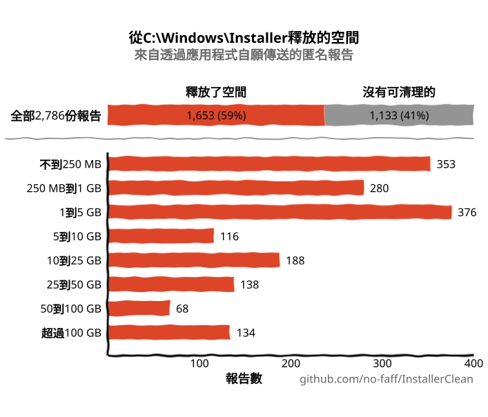
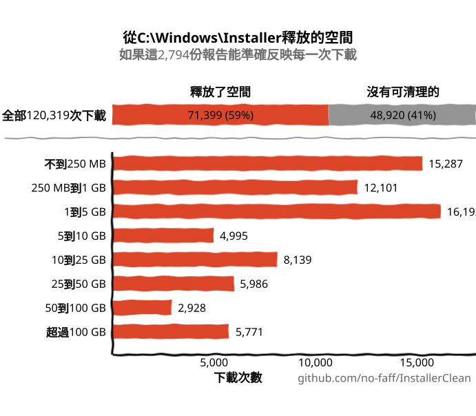
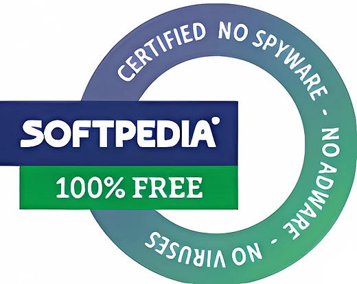
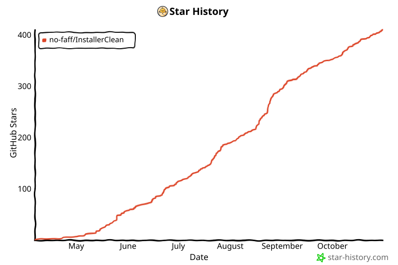

<p align="center">
  <a href="README.md">English</a> · <a href="README.zh-CN.md">简体中文</a> · <strong>繁體中文</strong> · <a href="README.ru.md">Русский</a> · <a href="README.es.md">Español</a> · <a href="README.ar.md">العربية</a> · <a href="README.ja.md">日本語</a> · <a href="README.pt-BR.md">Português (BR)</a> · <a href="README.pl.md">Polski</a> · <a href="README.tr.md">Türkçe</a> · <a href="README.ko.md">한국어</a> · <a href="README.fr.md">Français</a> · <a href="README.it.md">Italiano</a> · <a href="README.de.md">Deutsch</a> · <a href="README.id.md">Bahasa Indonesia</a> · <a href="README.vi.md">Tiếng Việt</a> · <a href="README.uk.md">Українська</a> · <a href="README.nl.md">Nederlands</a>
</p>

<p align="center">
  
</p>

<p align="center"><em>🎶 What's my line? I'm happy <a href="https://www.youtube.com/watch?v=HM-jHhUZfFI">cleaning Windows</a></em></p>

<h1 align="center">InstallerClean</h1>

<p align="center"><strong>一款開源工具，安全清理 <code>C:\Windows\Installer</code>，這個悄悄吃掉您磁碟空間的隱藏 Windows 資料夾。</strong></p>

<p align="center"><em>久久用上一次。說不定能省下一點空間。一身清爽，繼續上路。</em></p>

<p align="center">
  <a href="LICENSE"></a>
  <a href="https://dotnet.microsoft.com/download/dotnet/10.0"></a>
  <a href="https://github.com/no-faff/InstallerClean/actions/workflows/ci.yml"></a>
  <a href="https://github.com/no-faff/InstallerClean/releases"></a>
  <a href="https://github.com/no-faff/InstallerClean/releases/latest"></a>
  <a href="https://github.com/no-faff/InstallerClean/releases"></a>
</p>

<a id="reports-stats"></a>

<!-- reports-stats-start chart-only (generated; do not hand-edit between these markers) -->
<p align="center">
  <picture>
    <source media="(prefers-color-scheme: dark)" srcset="docs/reports-zh-TW-dark.svg" />
    <source media="(prefers-color-scheme: light)" srcset="docs/reports-zh-TW-light.svg" />
    
  </picture>
</p>

<details>
<summary>如果這 2,823 份報告能準確反映每一次下載</summary>

<p align="center">
  <picture>
    <source media="(prefers-color-scheme: dark)" srcset="docs/reports-zh-TW-scaled-dark.svg" />
    <source media="(prefers-color-scheme: light)" srcset="docs/reports-zh-TW-scaled-light.svg" />
    
  </picture>
  <br>
  <sub>上方每個數字都乘以 42.73，也就是下載次數除以報告數。</sub>
</p>

</details>
<!-- reports-stats-end -->

- **簡介：** InstallerClean 只做一件事：清除 `C:\Windows\Installer` 裡不需要的檔案，這個隱藏資料夾會隨著您安裝和更新軟體而越塞越滿。快速掃描之後，它會告訴您有沒有這類檔案，想細看的人還能看到更多詳細資料，並讓您把它們移到別處，或者刪掉，替 C: 磁碟機騰出空間。
- **您可能是為了這個而來：** 您用 [WinDirStat](https://github.com/windirstat/windirstat)、WizTree 或 TreeSize 時，看到 `C:\Windows\Installer` 佔了一大堆空間，卻不知道裡面是什麼。這種情況下，InstallerClean 正是您需要的。像 `9f05cba.msi` 這種名字看起來毫無規則的檔案，它知道裡面是什麼，而且很快就會告訴您哪些可以安全清除。
- **能騰出多少空間：** 上面的圖表來自 v1.8.0 以來陸續傳回來的選擇性報告。（謝謝每一位傳送過報告的人。沒有你們，就沒有上面這張圖。）在釋放了空間的那 <!-- reports-freedpct-start -->59%<!-- reports-freedpct-end --> 當中，釋放空間的中位數是 <!-- reports-median-start -->1.9 GB<!-- reports-median-end -->。<!-- reports-biggest-start -->有一台電腦足足釋放了 819 GB。<!-- reports-biggest-end -->另外 <!-- reports-nothingpct-start -->41%<!-- reports-nothingpct-end --> 什麼也沒釋放，所以要看是哪台電腦：一台沒裝額外軟體、剛裝好的 Windows 11 就沒有什麼可清的。不需要的檔案最多的，是用了好多年的電腦、裝著大型 MSI 軟體的電腦（Acrobat、Office、LibreOffice、大型開發工具），以及經常裝了又解除安裝的人。一執行，您就會看到自己這台到底有多少。
- **安全嗎：** 安全。它動到的只有 `C:\Windows\Installer` 裡的檔案。它會問 Windows Installer 哪些還需要，同時也從登錄把同一批記錄再讀一遍。只有當這台電腦上沒有任何已安裝的東西認領某個檔案，或者較新的修補程式已經取代了它、而且這裡沒有任何程式還能退回到舊的那個時，它才會把這個檔案提供出來。凡是它得不到明確答案的，一律保留。[詳見下文](#運作原理)。
- **不碰您的任何資訊：** 開源（Apache 2.0）。不用帳戶，沒有廣告，沒有追蹤，也沒有任何東西在背景執行。它會在您執行時到 GitHub 查一下有沒有新版本，這可以關掉；它在一台電腦上第一次執行完成時，會傳送一份關於這次執行情況的匿名報告，除非您在結果畫面上取消勾選那個方塊。
- **取得方式：** [下載最新版本](../../releases/latest)。執行它；按過 [Windows 顯示的任何警告](#unknown-publisher)和[系統管理員提示](#admin)。把它找到的檔案移走或刪掉。完成。

[](https://ko-fi.com/nofaff)

## 目錄

- [沒有人告訴您的資料夾](#沒有人告訴您的資料夾)
- [尋求協助](#尋求協助)
- [InstallerClean 做什麼](#installerclean-做什麼)
- [螢幕擷取畫面](#螢幕擷取畫面)
- [運作原理](#運作原理)
- [下載](#下載)
  - [檢查下載的檔案本身](#檢查下載的檔案本身)
- [常見問題](#常見問題)
- [命令列](#命令列)
- [協助工具](#協助工具)
- [程式碼簽署原則](#程式碼簽署原則)
- [隱私權](#隱私權)
- [它不做什麼](#它不做什麼)
- [其他工具](#其他工具)
- [如果 C:\Windows\Installer 裡少了檔案](#recovery)
- [系統需求](#系統需求)
- [從原始碼建置](#從原始碼建置)
- [參與貢獻](#參與貢獻)
- [支持本專案](#支持本專案)
- [Star 歷史](#star-歷史)
- [授權條款](#授權條款)

---

## 沒有人告訴您的資料夾

每台 Windows 電腦上都有一個名為 `C:\Windows\Installer` 的隱藏資料夾。每當您安裝使用 Windows Installer 機制的軟體，或替 Microsoft Office、Adobe Acrobat、Visual Studio 等任何以 `.msi` 為基礎的應用程式套用修補程式時，那個安裝程式或 `.msp` 修補程式檔案的副本就會放進這個資料夾，然後一直留在那裡。

較新的修補程式取代較舊的時，兩個都還在。很久以前就解除安裝的軟體，它們的安裝程式也還在。磁碟清理完全不碰這些，儲存空間感知器也一樣。DISM 管的則是另一個資料夾。時間一久，資料夾越來越大：1 GB、5 GB、20 GB、50 GB。在大量使用 MSI 軟體的電腦上（Acrobat 是常見的元兇），它可以[超過 100 GB](https://www.reddit.com/r/sysadmin/comments/1oxcrmh/acrobat_filling_up_the_cwindowsinstaller_folder/)。

這些不是那種刪了又會自己冒出來的暫存檔。它們是貨真價實的累贅：多年前解除安裝的軟體留下的舊安裝程式，以及被取代了好幾次的修補程式。一旦清掉，就不會再回來。

**如果您想找個簡單的方法替 Windows 騰出磁碟空間，從這個資料夾下手是個好開始。** InstallerClean 會找出不需要的檔案，並安全地清除它們。

## 尋求協助

如果您曾經為了這個資料夾上網求助，大概就知道結局會是什麼樣子。有人的 `C:\Windows\Installer` 有 180 GB，問要怎麼清理。[得到的回答是執行磁碟清理](https://learn.microsoft.com/en-us/answers/questions/4238108/windows-installer-folder-has-occupied-180gb)。一試，清出了 600 MB，卻沒有一點來自那個資料夾（因為磁碟清理根本不碰 `C:\Windows\Installer`）。然後討論串就沒了下文。

> *「我找到的討論串都在推薦同樣那幾招，根本解決不了問題，然後就沒人回了。」*
>
> [ksparks519, r/Windows10](https://www.reddit.com/r/Windows10/comments/1bt8c5p/anyone_ever_figure_out_giant_installer_folders/)（譯自英文原帖）

要不然就是叫人乾脆別碰它。在某個討論串裡，有人的 Installer 資料夾有 60 GB，得到的回覆是[「別去動它」](https://www.reddit.com/r/techsupport/comments/1hw4suq/my_windows_installer_folder_is_like_60gb_so_i/)。提問的人追問那該怎麼辦，回覆是：*「我剛剛不是說了嗎。」*

一般的建議把兩件不同的事混為一談。隨便亂刪檔案，會讓那些檔案所屬的程式再也無法更新或解除安裝。只清除這台電腦上沒有任何東西認領的檔案，或 Windows 記錄為已被取代的檔案，則不會。InstallerClean 做的是後者。

## InstallerClean 做什麼

1. **掃描** `C:\Windows\Installer`，找出其中的 `.msi` 和 `.msp` 檔案
2. **詢問** Windows Installer 哪些還需要，同時也從登錄把同一批記錄再讀一遍
3. **保留**兩次讀取之間無法定論的一切
4. **告訴您能釋放多少**，以及有多少原樣保留，還可以另外開啟詳細資料視窗，逐一列出每個檔案
5. **清除不需要的檔案**：把它們移到您選擇的備份資料夾，或永久刪除

## 螢幕擷取畫面

<p>
  <br>
  <em>初始掃描。非常快。</em>
  <br><br>
</p>

<p>
  <br>
  <em>結果：有多少可以清除，有多少原樣保留。</em>
  <br><br>
</p>

<p>
  <br>
  <em>可以清掉的那些檔案的詳細資料：每一個為什麼不再需要，以及檔案本身是怎麼描述自己的。</em>
  <br><br>
</p>

<p>
  <br>
  <em>原樣保留的那些檔案的詳細資料：Windows 說每一個屬於哪個程式，以及檔案本身是怎麼描述自己的。</em>
  <br><br>
</p>

<p>
  <br>
  <em>兩種動作之前都會先確認。「移動」會把檔案備份到您選擇的資料夾。或者直接永久刪除。</em>
  <br><br>
</p>

<p>
  <br>
  <em>移動進行中。移到同一個磁碟機上是一瞬間的事。移到另一個磁碟機上，GB 越多，花的時間越久。</em>
  <br><br>
</p>

<p>
  <br>
  <em>完成。空間拿回來了。檔案先備份著，等您確定一切正常為止。然後把備份資料夾刪掉。</em>
  <br><br>
</p>

<p>
  <br>
  <em>再次掃描之後。已經沒有什麼可清的了。</em>
  <br><br>
</p>

<a id="is-it-safe"></a>
## 運作原理

Windows Installer 安裝一個程式時，會把安裝程式的一份副本留在 `C:\Windows\Installer` 裡；當一個修補程式登錄到某個程式上時，也會留下那個修補程式的副本。日後修復、更新或解除安裝這個軟體時，靠的就是這些副本，這也是為什麼安裝早就結束了，它們卻還留在那裡。兩種副本最後都進了這個資料夾：`.msi` 安裝程式；以及 `.msp` 修補程式，修補程式是替您已經裝好的程式做更新，而不是把它整個換掉。

InstallerClean 只會出於兩個原因之一提供某個檔案。

**孤立**的意思是，這台電腦上沒有任何東西認領這個檔案。沒有任何已安裝的產品、也沒有任何已登錄的修補程式指名這個檔案。

**已被取代**的意思是，Windows 記錄了這個修補程式已經被一個較新的修補程式取代，卻照樣把檔案留著。只有當一個修補程式所登錄到的每一個程式都已解除安裝，或者這個修補程式已從所有這些程式上移除時，那個修補程式才會被刪掉。被較新的取代，這兩種情況都不算，所以檔案就留下來了。Adobe Acrobat 在 Windows 上就是這樣運作的：它的更新是以修補程式的形式套用在一份基礎安裝上，而不是全新的安裝程式，所以一台裝了它一段時間的電腦上，可能存著好幾個。

InstallerClean 判定這兩者的方向正好相反，而且只有前一種才需要去看資料夾裡有什麼。

**列出資料夾。** InstallerClean 會列出直接放在 `C:\Windows\Installer` 裡的 `.msi` 和 `.msp` 檔案。它不會進入子資料夾。

**把記錄讀兩遍。** 它呼叫 `msi.dll` 裡的 Windows Installer API，向 Windows Installer 要每一個已安裝的產品、每一個已登錄的修補程式，以及它們各自指名的快取檔案。然後它換一種方式把同樣的記錄再讀一遍，直接從登錄讀，因為前一種問法可能少給了卻不吭聲：Windows 是一筆一筆地交出記錄，直到它說沒有了為止，而在兩百筆中停在第三筆的那一次執行，看起來跟讀到最後的那一次一模一樣。登錄機碼則是一次就交出它整份名稱清單，所以一份短少的清單不可能看起來是完整的。凡是登錄指名、而前一種問法漏掉的產品，都會依名稱一個一個再交回給 Windows 去問。這第二次讀取只能把檔案移到「仍然需要」那一邊。沒有任何途徑能讓它把檔案放進要清除的清單裡。

**把記錄和它的檔案對起來。** 一筆記錄是用路徑來指名它的快取檔案的，而同一個資料夾在這些記錄裡不一定寫成同一個樣子。所以 InstallerClean 不相信這個寫法，而是問 Windows 每一筆記錄裡的路徑實際指向哪裡，再拿這個結果和資料夾裡列出的那些檔案比對。仍然沒人認領的，還要再經過一次完全不靠名稱的比對：它開啟檔案，請 Windows 辨識這是哪一個檔案，這樣同一個檔案的兩個不同名稱就會被認出是同一個檔案。

**對不起來的記錄。** 如果 Windows 不肯說某筆記錄裡的路徑指向哪裡，或者辨識不出路徑盡頭的那個檔案，InstallerClean 就不知道那筆記錄說的是哪個檔案，而它列出的任何一個檔案都可能就是那一個。某個程式可能安裝了不只一次時也一樣，因為那時它分不清哪個快取檔案屬於哪一份安裝。遇到上述任何一種情況，它這一次就不會提供任何靠列出資料夾找到的檔案。一筆指向早已不在的檔案的記錄則是另一回事：已經沒有東西讓它去指了，所以它說的不可能是資料夾裡還在的任何一個檔案。

**從另一頭問起。** 孤立是靠「沒有」來判定的，而「沒有」也可能表示應用程式沒找到那筆記錄。所以在提供一個 `.msi` 安裝程式之前，InstallerClean 會開啟這個檔案，讀出檔案本身帶著的產品代碼，再問 Windows 那個產品是否已安裝。如果已安裝，這個檔案就留下，不管掃描的其他部分找到了什麼。這項檢查只能把檔案從清單上拿掉。它給出的任何答案，都不會把檔案放上去。

**`.msp` 修補程式是怎麼判定的。** 修補程式不會被開啟來詢問它屬於哪個程式。真正起決定作用的，是一筆修補程式登錄會在兩個地方指名它的快取檔案：登錄到每個產品上的那些修補程式；以及記錄這台電腦上全部修補程式登錄的那一份登錄清單。只有這兩處都沒有指名它時，一個修補程式才會被當作孤立檔案提供出來。

**已被取代的修補程式哪裡不一樣。** 上面這些它一項都不經過，因為它不是一個沒人認領的檔案。Windows 有它的記錄，而正是那筆記錄說它已經被取代了。這裡的風險是另一種：一個修補程式可以登錄到好幾個程式上，而其中只有一個已經用不到它了。所以只有在以下幾點全部成立時，一個已被取代的修補程式才會被提供出來：Windows 記錄它無法解除安裝；它登錄到的每一個程式都問過了；這些程式沒有一個還套用著它；而且這些程式沒有一個還持有 Windows 說可以解除安裝的修補程式。最後這一條之所以存在，是因為在某個程式上復原一個修補程式，可能會回頭去找那個較舊的檔案。上述任何一點得不到答案，檔案就留下。

<details>
<summary>這裡用到的 Windows Installer 呼叫</summary>

- `MsiEnumProductsEx` 列出每一個已安裝的產品；用單一產品代碼再呼叫一次，則是問某個特定產品是否已安裝
- `MsiEnumPatchesEx` 列出已登錄的修補程式，既按產品列，也在整台電腦的範圍內列
- `MsiGetProductInfoEx` 讀取一個產品的名稱、它指名的快取檔案，以及它是不是同一產品的多份安裝之一
- `MsiGetPatchInfoEx` 讀取一個修補程式的狀態、Windows 能否解除安裝它，以及它指名的快取檔案
- `MsiGetSummaryInformation` 和 `MsiSummaryInfoGetProperty` 從修補程式檔案裡讀出它可以套用到哪些程式上
- `MsiOpenDatabase`、`MsiDatabaseOpenView`、`MsiViewExecute`、`MsiViewFetch` 和 `MsiRecordGetString` 從安裝程式檔案裡讀出它宣告的產品代碼

</details>

話雖如此，應用程式還是鼓勵您把檔案移到一個備份資料夾（如果您是想替 C 磁碟機騰出空間，就放到另一個磁碟機或分割區上）。這樣在最後刪掉這些不需要的檔案之前，您有機會自己確認一切真的都正常。

## 下載

三種版本，任選其一：

- **Portable**（`InstallerClean-portable.exe`）：單一檔案，.NET 10 執行階段就包在裡面。不用安裝，也沒有解除安裝程式：按兩下就能執行。把檔案留著下次再用，或用完就刪掉。
- **Setup**（`InstallerClean-3.5.0-setup.exe`）：一般的 Windows 安裝程式，內附 .NET 10 執行階段。會在「開始」功能表加入一個項目，解除安裝也乾乾淨淨。收在「程式集」裡，半年後也好找；如果您經常裝了又解除安裝軟體，要更常用它也方便。
- **CLI**（`installerclean-cli.exe`）：單獨的命令列版本，一個檔案，執行階段就包在裡面。不用安裝，也沒有解除安裝程式。把它放到用戶端上，跑一次掃描或清理，再刪掉。它是為指令碼、排程工作和大量部署而做的，適合只想執行這些操作、又不想在用戶端裝桌面應用程式的情況。參數和結束代碼請見[命令列](#命令列)。

從 2.2.0 起，安裝版和可攜版的檔名都帶有版本號，下載下來的副本永遠說得清自己是哪一版；命令列版則保留單純的 `installerclean-cli.exe` 檔名，這樣指向它的排程工作和指令碼在更新後依然能用。

從[發行頁面](../../releases/latest)下載，然後執行。它沒有簽章，所以 Windows 會顯示「發行者不明」警告；[常見問題](#unknown-publisher)說明了您會看到什麼，以及為什麼這麼做是安全的。

應用程式啟動時會自動掃描。檢查結果，然後按「**移動**」或「**永久刪除**」。

或者透過 [winget](https://learn.microsoft.com/windows/package-manager/winget/) 安裝：

```
winget install NoFaff.InstallerClean
```

或者透過 [Scoop](https://scoop.sh) 安裝：

```
scoop install installerclean
```

### 檢查下載的檔案本身

InstallerClean 沒有簽章。在執行它之前，您可以檢查這些：

- 每個下載檔案的 SHA-256 都列在它的發行頁面上。
- VirusTotal：每個版本在發出之前都會先掃描，發行頁面上附有每個下載檔案逐一引擎的完整結果。
- 原始碼就在 [github.com/no-faff/InstallerClean](https://github.com/no-faff/InstallerClean)。掃描、查詢、移動、刪除、設定和待重新啟動這幾項服務都由一套自動化測試涵蓋，每次推送到 `main` 以及每個 pull request 都會在 Windows 上執行，本頁頂端的 CI 徽章會顯示結果。
- 發行版本的建置是確定性的：相同的原始碼、相同的 SDK 和相同的發行參數會產生相同的位元組，而且除非每一項建置輸入都和該標籤的原始碼一致，否則一個版本無法加上標籤。所以您可以簽出標籤、自己建置一次，再把雜湊值和公布的比對。每個版本的發行說明都附有您需要的資訊：建置時用的 SDK 版本，以及任何不是用預設值建置的下載檔案所用的發行參數。安裝程式是例外：它是由 Inno Setup 而不是 SDK 編譯的，而且會把建置的年份寫進檔案本身，所以要重現它的雜湊值，還需要相同的 Inno 版本和相同的年份。
- 在 GitHub、MajorGeeks 和 Softpedia 上累計 <!-- downloads-start -->120,000+<!-- downloads-end --> 次下載。
- [MajorGeeks](https://www.majorgeeks.com/files/details/installerclean.html) 會在虛擬機器中測試每一個送審的版本，只有通過他們的審查才會收錄。<br><a href="https://www.majorgeeks.com/files/details/installerclean.html"></a>
- [Softpedia](https://www.softpedia.com/get/System/Hard-Disk-Utils/InstallerClean.shtml) 審查過它，並認證它不含間諜軟體、廣告軟體和病毒。<br><a href="https://www.softpedia.com/get/System/Hard-Disk-Utils/InstallerClean.shtml"></a>

## 常見問題

<a id="admin"></a>

**為什麼它需要系統管理員權限？** 有兩個原因。`C:\Windows\Installer` 被鎖定為只有系統管理員能存取，所以讀取它、查詢 Windows Installer、移動或刪除檔案，都需要系統管理員權限。另外，系統管理員可以向 Windows 詢問這台電腦上任何帳戶所安裝的程式，非系統管理員則不行：不以系統管理員身分執行的話，在那項判定檔案是否仍然需要的檢查裡，Windows 會把一個其實已安裝的程式說成沒有安裝。

<a id="unknown-publisher"></a>

**為什麼 Windows 說「發行者不明」？** InstallerClean 沒有程式碼簽章，而 Windows 會替從網路下載的檔案加上標記，所以第一次執行時，SmartScreen 通常會顯示「Windows 已保護您的電腦」，發行者則列為不明。付費的簽章憑證每年都要花錢，我寧可讓應用程式保持免費，也不想花這筆錢，所以我向免費替開源軟體簽章的 SignPath Foundation 提出申請，InstallerClean 也已獲准（請見[程式碼簽署原則](#程式碼簽署原則)）。憑證還沒有核發，所以目前請按「**其他資訊**」，再按「**仍要執行**」。這麼做是安全的：原始碼是公開的，每個版本都有 VirusTotal 連結和 SHA-256 雜湊值，您可以先檢查。

**能在 Windows 7 或 8 上使用嗎？** 不能。它需要 Windows 10 版本 1607 或更新版本，這是 .NET 10 執行階段支援的最舊版本。安裝程式在更舊的系統上會拒絕安裝，可攜版也無法啟動。

## 命令列

`installerclean-cli.exe` 是一個獨立的主控台執行檔，和圖形介面安裝在一起。一樣的掃描、一樣的移動、一樣的刪除，只是沒有視窗。它會佔住命令提示字元直到執行完畢，所以指令碼或排程工作可以等它完成。

### 參數

| 參數 | 作用 | 也接受 |
|---|---|---|
| `/s` | 只掃描。列出它會清除哪些檔案，附上每個檔案的名稱、大小和原因。不更動任何東西。 | |
| `/d` | 先掃描，再永久刪除不需要的檔案。 | |
| `/m` | 先掃描，再把它們移到圖形介面中儲存的那個資料夾。 | |
| `/m 路徑` | 先掃描，再把它們移到 `路徑`。路徑裡有空格的話請加上引號。 | |
| `--help` | 印出用法說明，並以 `0` 結束。 | `/?`、`-h` |
| `--version` | 印出版本，並以 `0` 結束。 | `-v` |

參數不區分大小寫，所以 `/S` 和 `/D` 跟 `/s` 和 `/d` 一樣可用。每次執行只能用一個參數：它們不能合併使用，而且 `/s` 和 `/d` 後面不接任何東西。

不帶參數執行時，它會印出用法說明並以 `1` 結束，這樣弄丟了參數的排程工作會明明白白地失敗，而不是悄悄地什麼也不做。遇到不認得的參數，它會先印出一行錯誤，再印出用法說明，同樣以 `1` 結束。含有空格卻沒加引號的移動路徑也會同樣被拒絕，而不是被悄悄截斷，訊息也會告訴您要加上引號。

### 結束代碼

以下是工具本身在 `--help` 中載明的代碼：

| 代碼 | 意義 |
|---|---|
| `0` | 成功。這次執行完成了要求的事，而且沒有任何失敗。 |
| `1` | 沒有處理任何項目。這次執行失敗，或被拒絕。 |
| `2` | 部分完成。有些處理了，有些沒有，包括中途按了 Ctrl+C。 |
| `75` | 暫時性。有暫時的狀況擋住了這次執行；印出的訊息會說明是哪一種。 |
| `130` | 在處理任何項目之前就按 Ctrl+C 取消了。 |

`1` 既包括失敗，也包括拒絕，而拒絕並不代表出了問題：目的地只是滿了，或者應用程式在動手之前讀不到某個登錄值，都會落在這裡。`0` 的意思是沒有任何失敗，而不是什麼都沒剩：`--help`、`--version` 和只掃描的執行都以 `0` 結束，不管這次掃描找到了六十八個檔案還是一個也沒有。

### 事件記錄檔

每次執行都會在應用程式記錄檔中寫入一筆結果項目，還可能在旁邊加上一筆或多筆通知。事件識別碼是一份穩定的、給機器讀的約定，所以 RMM 可以只靠號碼篩選，不必剖析任何文字：

| 識別碼 | 意義 |
|---|---|
| `1000` | 成功 |
| `1002` | 部分完成 |
| `2000` | 已略過，暫時性 |
| `4000` | 嚴重失敗 |
| `3000` | 通知：掃描無法交代每一個已安裝的產品 |
| `3001` | 通知：Windows 預期應該存在的檔案不在資料夾中 |
| `3002` | 通知：有檔案被保留下來，沒有提供 |

`3000` 這一段是通知而不是結果，不算作一次執行的結果。執行沒有出錯時，項目類型是「資訊」，出了錯則是「警告」。**事件記錄檔一律是英文**，不管電腦的顯示語言是什麼，這樣用已知的字句搜尋才有穩定的目標。經過翻譯的是主控台：它跟隨電腦本身的語言，大小和日期也採用所在地區的寫法。

### 使用範例

把稽核結果寫入檔案，不更動任何東西：

```
installerclean-cli /s > audit.txt
```

每月移動到 `D:\InstallerBackup`，CLI 放在 `C:\Tools`：

```
schtasks /create /tn "InstallerClean monthly" /tr "C:\Tools\installerclean-cli.exe /m D:\InstallerBackup" /sc monthly /ru SYSTEM /rl highest
```

工作會一直等到這次執行結束，並把結束代碼記錄為它的「上次執行結果」，所以 RMM 可以根據上面那些代碼來判斷。

在 PowerShell 中：

```powershell
& 'C:\Tools\installerclean-cli.exe' /m D:\InstallerBackup
switch ($LASTEXITCODE) {
    0       { '乾淨' }
    2       { '部分完成，請檢查輸出' }
    75      { '被擋住了，請稍後再試' }
    default { "失敗（$LASTEXITCODE）" }
}
```

### 寫進指令碼之前

- **它需要提高權限。** 全部都需要，`/s` 也不例外。從沒有提高權限的命令提示字元執行，Windows 會拒絕啟動它，並把 `740` 交給您的 shell。
- **圖形介面中儲存的資料夾是依使用者儲存的。** 以 SYSTEM 或服務帳戶身分執行的工作看不到它，所以這類執行必須傳入 `/m 路徑`。
- **SYSTEM 是以電腦帳戶的身分存取網路的**，所以 `\\伺服器\共用資料夾` 這樣的目的地，需要把權限給那個帳戶。
- **`/s` 從不等候。** 它是唯讀的，不取用任何鎖定，所以桌面應用程式開著的時候也能掃描。`/d` 和 `/m` 會取用一個全電腦範圍的鎖定，如果另一次 InstallerClean 執行正持有它，就以 `75` 結束。
- **所有輸出都送到 stdout**，錯誤也一樣；沒有 stderr。請根據結束代碼判斷，而不是去剖析文字。
- **移動會拒絕，而不是重新命名。** 如果目的地已經有同名的檔案，那個檔案就留在快取中，並在輸出中點名，這一批的其他檔案照樣移動。如果每個檔案都撞名，這次執行就什麼也沒處理，以 `1` 結束。
- **沒有任何東西會清空備份資料夾。** `/m` 只會往裡面加。那個資料夾需要您自己清理。
- **`taskkill /pid` 不是正常的取消方式。** 單一執行個體的鎖定會由下一次執行收回。
- **第一次執行會登錄一個事件記錄檔來源**，位置在 `HKLM\SYSTEM\CurrentControlSet\Services\EventLog\Application\InstallerClean`。請把它留著：事件檢視器是透過來源來讀取項目的描述，刪掉它會讓這個工具已經寫下的每一筆項目都變成來源不明的錯誤。

### 為什麼是 `installerclean-cli` 而不是 `installerclean.exe`

`InstallerClean.exe` 是那個視窗，它不理會命令列引數。`installerclean-cli.exe` 是一個真正的主控台處理程序，所以它會佔住命令提示字元直到執行完畢，重新導向和管線也跟其他程式一樣。安裝程式會把兩個都裝上。可攜版下載只有圖形介面；如果您想要不帶視窗的命令列，請從[發行頁面](../../releases/latest)單獨下載 `installerclean-cli.exe`。

## 協助工具

InstallerClean 的設計目標，是完全可以只用鍵盤和螢幕閱讀程式來操作。

- **全程都能用鍵盤操作。** 應用程式做的每一件事都能用鍵盤到達，詳細資料視窗裡的各欄也能用鍵盤排序，所以這裡沒有任何地方非用滑鼠不可。標題列按鈕的行為和 Windows 本身的一樣，可以用 Alt+Space 或 Alt+F4 操作。鍵盤焦點不管落在哪裡都看得見。
- **朗讀程式與語音存取。** 每個控制項都有標籤，按鈕上看得到的字，就是用語音啟動它時要說的字。移動或刪除完成時，結果會朗讀出來。
- **為閱讀而設計。** 整個深色主題的文字都符合 WCAG AA 對比標準。

如果這裡有任何地方妨礙到您，請[提出 issue](../../issues)。協助工具的問題是 bug，不是少見的特殊情況。

## 程式碼簽署原則

InstallerClean 已獲 [SignPath Foundation](https://signpath.org) 接受，可以免費取得程式碼簽章。這是一項替開源軟體簽章的計畫，簽章之後，軟體到您電腦上時就不會再顯示發行者不明。憑證本身還沒有核發，所以這裡的下載目前都沒有簽章，Windows 會對它們發出警告。

憑證核發之後，每個發行版本都會附上 SignPath 要求的那行字：free code signing provided by SignPath.io, certificate by SignPath Foundation。憑證屬於基金會而不是我，因為憑證必須核發給一個法律實體，而一個人的專案不是。這並不表示 InstallerClean 是他們的，也不表示除了簽章之外他們還參與了什麼。

**角色。** InstallerClean 只有一位維護者。提交者與審查者，也就是誰能把程式碼放進專案：我。核准者，也就是誰能授權替一個發行版本簽章：我。

## 隱私權

InstallerClean 在一台電腦上第一次執行完成時，結果畫面上會有一個「傳送匿名報告」方塊，關閉這個畫面時報告就會送出，除非您取消勾選。每台電腦最多只會有一份報告。如果 Windows 設定的國家或地區是歐盟成員國、冰島、列支敦斯登或挪威，或者 InstallerClean 讀不到這項設定，這個方塊一開始就是未勾選的。報告的內容是：掃描找到了什麼、保留了什麼以及原因、您是移動還是刪除、這次釋放了多少、花了多久、有什麼失敗了，再加上應用程式的版本、您閱讀它時用的語言、Windows 設定的語言，以及您的 Windows 版本。沒有檔名，沒有資料夾名稱，沒有帳戶名稱，沒有任何能辨識您電腦的東西，也沒有任何能把兩份報告連在一起的東西。方塊旁邊的小「i」會列出報告包含哪些內容，「查看傳送的確切內容」則會把報告本身顯示給您看。本頁頂端的圖表就是根據這些報告畫出來的，所以任何人都能看到大家實際拿回了多少空間。這些報告也讓我知道，這個應用程式在我自己以外的電腦上是否正常運作，以及它保留了些什麼。

沒有廣告。其他的連線只有應用程式啟動時的版本檢查（向 GitHub 發出一個要求，可以在「關於」視窗中關掉），以及連到 GitHub 和贊助頁面的按鈕，贊助全憑您的心意。完整的[隱私權政策](PRIVACY.md)（英文）。

## 它不做什麼

- WinSxS（`C:\Windows\WinSxS`）是另一個資料夾，規則也不同。要清理那個，請在提高權限的命令提示字元中執行 `Dism /Online /Cleanup-Image /StartComponentCleanup`。
- 沒有背景服務，沒有排程工作，沒有自動清理。應用程式只在您啟動它時執行。
- 它不會更動您已安裝的程式或 Windows Installer 資料庫，只會讀取它們。它會在登錄中寫入兩樣東西：命令列工具需要的一次性事件來源登錄，讓它的執行記錄能出現在 Windows 事件記錄檔中；以及一個記錄這台電腦已完成第一次執行的值，這樣匿名報告只會提供一次。
- 它自己主動發起的連線有兩種：執行時快速檢查 GitHub 的發行頁面有沒有新版本（您可以在「關於」中關掉），以及一台電腦第一次執行完成後送出的匿名報告（關於這次執行的一些數字，沒有任何指出您或您檔案的內容），除非您取消勾選它的方塊。其他的都只在您要求時才發生：連到 GitHub 文件和贊助頁面的連結，您按了才會在瀏覽器中開啟。
- 沒有工具列，沒有附帶軟體，沒有廣告軟體。

## 其他工具

如果您以前搜尋過這個資料夾，最可能找到的工具就是 [PatchCleaner](https://www.homedev.com.au/free/patchcleaner)。是它先做了這件事，在 InstallerClean 出現之前已經做了十年，到現在依然好用，而且沒有它就不會有 InstallerClean。

我做 InstallerClean，是因為 PatchCleaner 不開源、自 2016 年 3 月以來就沒有更新過，而且預設排除 Adobe 的檔案。那條排除規則有它充分的理由，HomeDev 當時在發行說明裡也講得很清楚：

> *「舊版有一個已知問題：PatchCleaner 會誤把 Adobe Acrobat Reader 的修補程式判定為不再需要。Adobe 在自動更新上有自己一套專屬的做法，如果 PatchCleaner 把安裝程式目錄裡那些『孤立』的修補程式刪掉，Adobe Reader 的自動更新就再也無法順利安裝了。」*
>
> [PatchCleaner 發行說明，版本 1.4.0.0](https://www.homedev.com.au/free/patchcleaner)（譯自英文原文）

隨之加入的那個篩選器，會在檔案的中繼資料和簽章裡找「Acrobat」這個字。在 Acrobat 是最大元兇的電腦上，那可能就是大部分的空間：

> *「我下載了 PatchCleaner 來刪除那些孤立的 .msp 檔案，但看起來這樣只能釋放 250 MB 的空間。有 29 GB 的檔案被『篩選器排除』了，所以 PatchCleaner 好像幫不上忙。」*
>
> HeatherBunny1111, [r/techsupport](https://www.reddit.com/r/techsupport/comments/1qc4tcf/how_to_delete_msp_files_safely/)（譯自英文原帖）

這兩個工具在這裡的差別，在於各自向 Windows 問了什麼，而不是對 Adobe 有不同的看法。Windows 為某個產品列出的*已套用*修補程式清單，並不包含那些已被較新修補程式取代的，所以讀這份清單的工具，遇到一個已被取代的修補程式的檔案時，看到的就是一個沒人認領的檔案，和其他檔案沒有兩樣。是那個排除篩選器依名稱把 Adobe 的那些挑了出來。InstallerClean 改為向 Windows 詢問修補程式的狀態，所以一個已被取代的修補程式送到它手上時就已經標明是被取代的，而怎麼處理它，取決於 Windows 對它的記錄，而不是它的名稱怎麼寫。兩者的比較如下：

| | **InstallerClean** | **PatchCleaner** |
|---|---|---|
| 最近更新 | 2026（持續維護中） | 2016 年 3 月 3 日 |
| 原始碼 | 開源（Apache 2.0） | 不開源 |
| 執行階段 | .NET 10（獨立式） | .NET Framework 4.5.2 + VBScript |
| API | `msi.dll` 中的 Windows Installer API（同一處理程序內） | Windows Installer COM（另一處理程序，透過 VBScript） |
| 已被取代的修補程式 | 從 Windows 的修補程式記錄中辨識出來 | 和沒人認領的檔案不加區分 |
| Adobe 檔案 | 偵測出已被取代的修補程式並加上標示 | 依名稱篩選排除，預設開啟 |

> **關於 `Win32_Product` 的說明：** 列出已安裝產品有一種常見卻有缺陷的做法，就是使用 `Win32_Product`（WMI），它會在列舉過程中[對每一個產品觸發 MSI 修復作業](https://gregramsey.net/2012/02/20/win32_product-is-evil/)。InstallerClean 和 PatchCleaner 都避開了它。InstallerClean 呼叫 `msi.dll` 中的 Windows Installer API；PatchCleaner 則執行一個使用 Windows Installer COM 物件的輔助指令碼。那個指令碼叫做 `WMIProducts.vbs`，這個名稱讓它看起來像是另一回事，但這個檔案其實是 Microsoft 自己的範例指令碼改了一處，它問的是 Windows Installer 而不是 WMI。它唯一會誤導人的，就是這個名稱。

磁碟清理、儲存空間感知器、CCleaner 和 BleachBit 都不會清理 `C:\Windows\Installer`。

<a id="recovery"></a>
## 如果 `C:\Windows\Installer` 裡少了檔案

如果那個資料夾裡真的少了一個檔案，那個檔案所屬的程式照樣能正常執行。但當您試著更新或解除安裝那個程式時，多半會失敗。Windows 去找這個檔案，找不到，這一步就停住了。

InstallerClean 的全部用意，就是只提供*不*需要的檔案讓您移動或刪除；不過它確實知道哪些檔案不見了，所以只要找到，就會用一個警告三角形標示出來，並附上一個指向這裡的連結。想修復那個程式，可以這樣做：

- 查出您已安裝的那個程式的版本號碼（設定 > 應用程式 > 已安裝的應用程式）
- 從程式的開發者下載**那個版本**的安裝程式。較新的版本不行，先解除安裝也不行：兩者都得先移除已經裝好的那一份才能繼續，而移除正是需要那個遺失檔案的步驟。
- 執行那個安裝程式
- 這應該會把檔案補回來，而且不會動到您的設定。在 InstallerClean 中重新掃描一次，如果成功了，那個警告就會消失。

不過 Microsoft 並不保證這樣一定有效。以下是它自己更完整的說法：

<details>
<summary>Microsoft 更完整的說法</summary>

*以下 Microsoft 引文均為英文原文。*

完整指引：[Restore missing Windows Installer cache files](https://learn.microsoft.com/en-us/troubleshoot/windows-client/application-management/missing-windows-installer-cache)，KB 2667628。

*問題不一定會馬上出現：*
> "If the installer cache is compromised, you may not immediately see problems until you take an action such as uninstalling, repairing, or updating a product."

*這些檔案每台電腦都不一樣，所以沒辦法從別的電腦複製一個過來：*
> "Missing files cannot be copied between computers because the files are unique."

*如果您有一份在檔案遺失之前做好的備份，Microsoft 依下列順序列出了四條路：*
> - System Restore points (available only on client operating systems)
> - Restoreable system state backup
> - Failure recovery methods that can restore the full system state backup
> - Reinstallation of the operating system and all applications

*而這四條都卡在同一件事上。這說的是系統備份，而不是您自己把檔案移過去的那個資料夾：那裡的檔案可以直接複製回去，複製進該資料夾時，確認 Windows 跳出的系統管理員提示就行了。*
> "To restore the missing files, a full system state restoration is required. It is not possible to replace only the missing files from a previous backup."

*建議的復原方法，以及它直截了當的限制：*
> "If application files are missing from the Windows Installer Cache, ask the vendor or support team for the application about the missing files. You must follow the procedures or steps recommended by the application vendor to restore the files. In some cases, you may have to rebuild the operating system and reinstall the application to fix the problem."
>
> "Windows support engineers cannot help you recover missing application files from the Windows Installer cache."

</details>

如果哪天有檔案是因為 InstallerClean 而不見的，我想知道。請[提出 issue](../../issues)，我會把它修好。

## 系統需求

- Windows 10（版本 1607 / 組建 14393 或更新版本，這是 .NET 10 執行階段支援的最舊版本）或 Windows 11
- 64 位元 Windows。安裝程式不會安裝到 32 位元系統上，並且會明確告訴您。
- 系統管理員權限，安裝程式和應用程式都需要（`C:\Windows\Installer` 只有系統管理員能存取）

安裝版、可攜版和 CLI 各版本的說明請見[下載](#下載)。

## 從原始碼建置

```
git clone https://github.com/no-faff/InstallerClean.git
cd InstallerClean
dotnet build src/InstallerClean.sln
```

執行測試：

```
dotnet test src/InstallerClean.Tests/
```

## 參與貢獻

發現了 bug，或有什麼建議嗎？請[提出 issue](../../issues)，或發起[討論](../../discussions)。歡迎提交 pull request。提交之前請先執行 `dotnet test`。

InstallerClean 提供 17 種語言，每一種都涵蓋它的全部：應用程式、安裝程式、命令列，以及這份 README。在應用程式、安裝程式和命令列中，日文和荷蘭文是由 coolvitto 和 RijckAlex 完整貢獻的，義大利文則是我自己的機器翻譯，經 bovirus 修正並認可，三位都是母語人士；其餘都是我自己的機器翻譯。每一份 README，不管哪種語言，都出自我自己之手。我在這上面下了很多功夫，但它們不會完美，而我決定照現在的樣子發布，而不是一直壓著，等到每一種語言都有母語人士檢查過為止。如果您懂英文和其中一種語言，發現任何可以改進的地方，我很樂意聽到，可以透過 [issue](../../issues/new?template=translation_review.md)、pull request 或[討論](../../discussions)告訴我。

## 支持本專案

如果 InstallerClean 替您騰出了一些空間，而您也願意的話，我會非常感謝您的[一點小額贊助](https://nofaff.netlify.app/support)。應用程式裡有一個 ❤️ 按鈕，連到同一個地方。多少都心懷感激地收下。非常感謝到目前為止贊助過的每一位。這是一份非常龐大的工作，我很高興它是值得的。

## Star 歷史

<picture>
  <source media="(prefers-color-scheme: dark)" srcset="docs/star-history-dark.svg" />
  <source media="(prefers-color-scheme: light)" srcset="docs/star-history-light.svg" />
  
</picture>

## 授權條款

[Apache 2.0](LICENSE)

---

🎶 [George Formby - When I'm Cleaning Windows](https://www.youtube.com/watch?v=P183Uo5Ust4). 好好欣賞吧！
